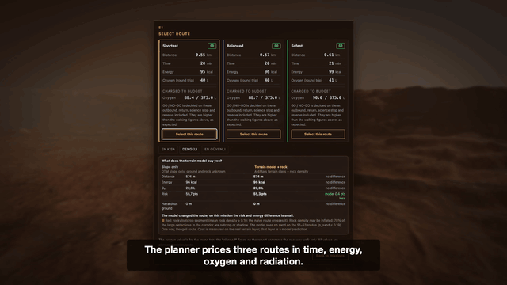
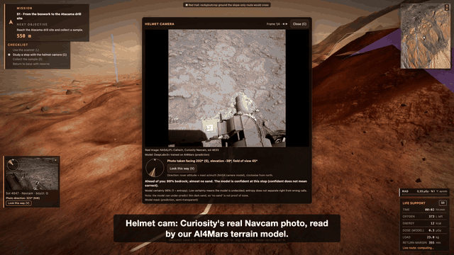
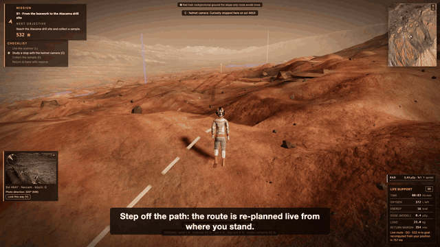
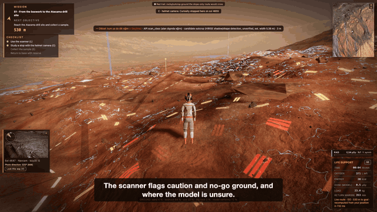
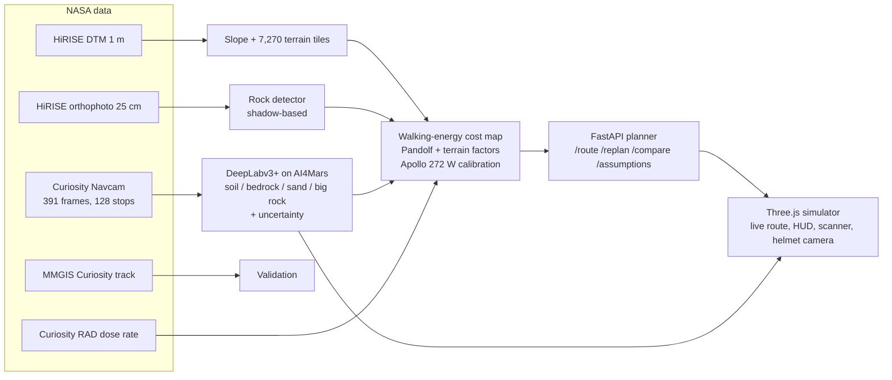
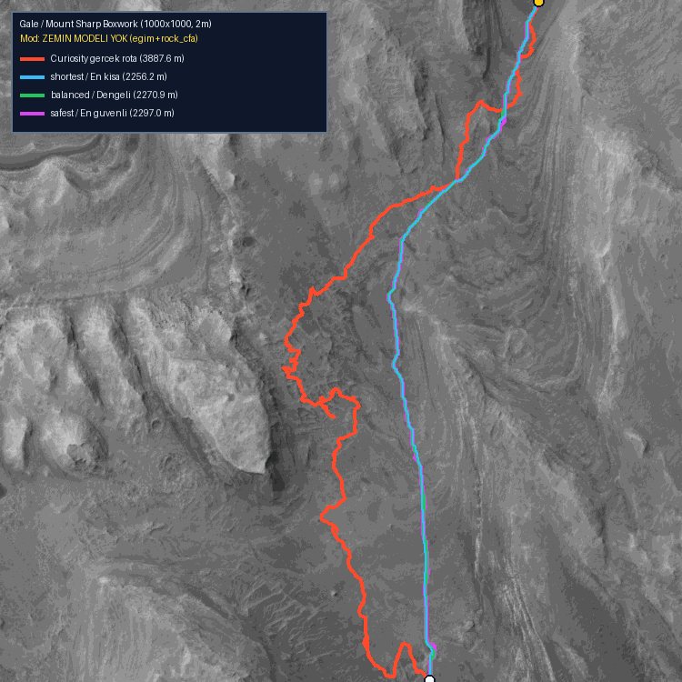
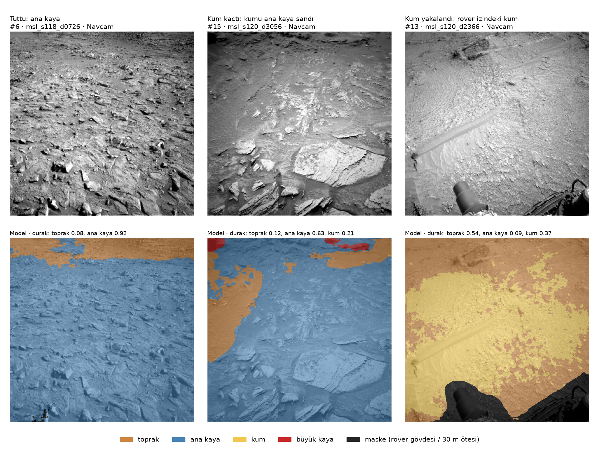

# Martian Map

**Rehearse a Mars spacewalk before you take it.**

Team **SÜNOVA** · NASA Space Apps Challenge 2026 · Konya, Türkiye · Challenge: *Interplanetary Survival Guide: Martian Map*

▶ **30-second demo video:** VIDEO_LINK  
📄 Project text: [`docs/submission/PROJECT.md`](docs/submission/PROJECT.md) · Model card: [`MODEL_CARD.md`](docs/submission/MODEL_CARD.md) · References: [`REFERENCES.md`](docs/submission/REFERENCES.md)

| Plan: three routes, each with a price | Rehearse: Curiosity's real photo, read by our model |
|---|---|
|  |  |
| **Walk: the route re-plans live from where you stand** | **Scan: caution, no-go, and "the model is unsure"** |
|  |  |

---

## The problem

In August 2014 Curiosity drove into *Hidden Valley* in Gale Crater, hit unexpectedly high wheel slip in sand, and the team backed out and took another way ([NASA/JPL, Aug 2014](https://science.nasa.gov/resource/looking-up-the-ramp-holding-bonanza-king-on-mars/)). A rover can wait. A suited astronaut's oxygen cannot.

On foot, the route sets the oxygen bill: walking on sand costs 2.1–2.7× the energy of firm ground at the same speed ([Lejeune et al. 1998](https://doi.org/10.1242/jeb.201.13.2071), Earth measurements), and a 20° slope is the limit NASA plans for suited walking. A line on a map does not show any of that. **Martian Map shows the price of a route in minutes, kcal, litres of O₂ and µGy before the astronaut steps outside, and lets them rehearse it on real terrain.**

## What it does

1. **Brief.** Pick a mission in Gale Crater's Mount Sharp boxwork area (where Curiosity worked in 2025–2026) or plan your own route between any two points; unreachable points are flagged before you compute.
2. **Plan.** The planner returns three routes (shortest, balanced, safest), each with time, energy, oxygen, dose, the steepest slope, a GO / NO-GO badge and a reason for every segment.
3. **Walk.** A 3D walk on the real HiRISE terrain. Oxygen, energy, time and dose drain with each step; a return-margin gauge tells you when to turn back.
4. **Re-plan live.** Step off the path and the line is recomputed from where you stand, about every 3 m or 4 s. A sand patch or a helmet-camera warning becomes an observation the next plan avoids.
5. **Look.** The helmet camera opens Curiosity's real Navcam photo of that spot, pointed in the direction it was taken, with our terrain model's reading on top. A slider blends real photo and simulator.
6. **Scan.** The scanner marks caution and no-go ground, and where the model has little evidence.
7. **Return and debrief.** Collect an 8 kg sample, walk back with the extra load, and compare plan with outcome.

## What is under the hood



**Things we built, with the evidence:**

| | What | Evidence |
|---|---|---|
| 1 | **Terrain model from rover images.** DeepLabv3+ (ResNet34) trained on AI4Mars, MC Dropout uncertainty, a U-Net that masks the rover body and ground beyond 30 m. Applied to 391 Navcam frames at 128 stops and spread onto a 2 m map. | Expert test: **mIoU 0.798**, large-rock recall **0.973**, calibration error **0.004** · [`MODEL_CARD.md`](docs/submission/MODEL_CARD.md), [`ml/rover_terrain/LAYERS.md`](ml/rover_terrain/LAYERS.md) |
| 2 | **Model in the browser.** Exported to ONNX (fp16, 44.9 MB) and run live in the helmet camera with onnxruntime-web (`?live=1`). | Pixel agreement with PyTorch **99.97%** on 12 frames · [`ml/rover_terrain/export_onnx.py`](ml/rover_terrain/export_onnx.py) |
| 3 | **Navcam photos pointed in 3D.** Each frame's direction computed from NASA's CAHVOR camera model and the rover's attitude quaternion, so the photo opens facing where it was taken. | 391 frames with direction · [`sim/data/navcam_dirs.json`](sim/data/navcam_dirs.json), [`data/navcam/manifest.csv`](data/navcam/manifest.csv) |
| 4 | **Terrain fixed to the photos.** Found a ≈30.7 m east / 33.5 m south shift between the simulator DEM and the orthophoto and corrected the tiles. | [`docs/sim/DEM_KAYMA.md`](docs/sim/DEM_KAYMA.md) |
| 5 | **Human energy, not rover distance.** Pandolf walking equation with Soule-Goldman terrain factors, scaled to the Apollo EVA average (272 W, NASA SP-368); 20° no-go (NASA EVA-EXP-0075), 15° caution; real rocks block the path. Every parameter is served with its source at `/assumptions`. | [`docs/metabolic_model.md`](docs/metabolic_model.md), [`api/planner/params.py`](api/planner/params.py), [`docs/eva_parameters.md`](docs/eva_parameters.md) |
| 6 | **Live re-planning.** The planner answers in under a second, so the route is recomputed from the astronaut's position as they walk, with the remaining budget and the return leg to base. | [`sim/app/liveroute.js`](sim/app/liveroute.js), [`api/`](api/) |
| 7 | **Honest by construction.** Measurements, model estimates and planning assumptions are labelled on screen; synthetic ground detail can be switched off ("pure data" mode); no number is shown that the planner did not compute. | [`docs/sim/VERI_KAYNAKLARI.md`](docs/sim/VERI_KAYNAKLARI.md) |

**At a glance**

| | |
|---|---|
| NASA data types in the core | 6 (HiRISE DTM, HiRISE orthophoto, Curiosity Navcam, AI4Mars, Curiosity RAD, MMGIS track) + CRISM for geology context |
| Real data in the repo | 7,270 terrain tiles (355 MB), 390 Navcam frames (111 MB), 390 model masks (42 MB) |
| Automated tests | 132 simulator tests (`node --test`) + 124 planner tests (`pytest`), all passing |
| Engineering | 101 merged pull requests, 456 commits, 7 team members in 48 hours |

## Does it hold up? (validation)

We report what held and what did not. Details: [`PROJECT.md` → Validation](docs/submission/PROJECT.md#validation-honest-numbers).

| Curiosity's real track vs our routes | Navcam photo vs model output |
|---|---|
|  |  |

- **Routes vs Curiosity:** same endpoints; Curiosity drove 3,887.6 m with science detours, our routes are 2,257.9–2,396.3 m and run on average ~130 m from its track. Geometry check only.
- **Terrain model:** mIoU 0.798 on 322 expert-labelled images; well calibrated per pixel (ECE 0.004).
- **Scanner vs Navcam:** matched 3 of 6 checked stops, 1 partly; both misses were sandy. **Sand is our weakest point** and the app says so.
- **With the 20° limit, slope and rocks decide the S1–S3 routes;** the terrain model's value is in the helmet camera, the ground readout and the uncertainty map.

## Run it (any machine, 2 commands)

Needs Python 3.10+ (Node.js optional, only for the web map). All terrain tiles, layers, Navcam frames and masks are in the repo.

```sh
git clone https://github.com/KebeliSamet0/martian-map.git && cd martian-map
bash scripts/setup.sh     # once: .venv + API dependencies
bash scripts/dev.sh       # planner API :8000 + simulator :8001
```

Open **http://127.0.0.1:8001/sim/?lang=en** (Turkish UI without `?lang=en`).
Controls: **W A S D** walk · **L** scanner · **C** helmet camera · **G / V** Navcam card and align view · **E** collect sample · **Esc** menu · **?** help.

Tests:
```sh
.venv/bin/python -m pytest -q      # planner API
node --test sim/tests/             # simulator logic
.venv/bin/python scripts/smoke.py  # end-to-end /route + /replan on real layers
```

## NASA data used

| Dataset | Used for |
|---|---|
| USGS MSL Gale Merged DEM 1 m v3 (HiRISE-based) | terrain mesh, slope, route cost |
| USGS MSL Gale Orthophoto Mosaic 25 cm v3 (HiRISE) | surface colour, rock detection |
| Curiosity Navcam raw images (NASA/JPL), sols 4580–4848 | terrain model input, helmet camera |
| AI4Mars (NASA rover images, volunteer and expert labels) | model training and testing |
| NASA/JPL MMGIS Curiosity traverse and waypoints | stops, validation, DEM check |
| Curiosity RAD surface dose rate (Hassler et al. 2014) | dose gauge |
| MRO CRISM MTRDR products | geology context for science stops |
| NASA SP-368, EVA-EXP-0075, NASA-STD-3001 | metabolic calibration, slope limit, suit and crew masses |

## Repository map

| Folder | Contents |
|---|---|
| `pipeline/` | DTM, orthophoto, slope, grid, CRISM, Curiosity track and stops |
| `ml/rover_terrain/` | terrain model training, inference on Navcam, masks, ONNX export |
| `ml/orbital/` | HiRISE rock detection and its validation |
| `api/` | planner: cost model, routing, re-planning, assumptions (FastAPI) |
| `sim/` | 3D simulator (Three.js): walk, life support, live route, scanner, helmet camera, debrief |
| `web/` | route map (React + Leaflet) |
| `docs/` | sources, metabolic model, EVA parameters, validation, submission |

## Honest limits

- Slope limits and the energy model come from Earth and lunar studies; they are not validated for suited humans on Mars and are labelled as planning assumptions.
- The terrain model under-calls thin dark sand in this region; sand in the demo mission is scenario-defined.
- Small rocks and ground texture in the 3D view are synthetic and labelled; the terrain shape is real HiRISE data.
- Not a flight or operations tool.

## Team SÜNOVA

Selçuk University, Konya. Samet (lead, planner API, integration) · Elif Rana (data pipeline) · Emre (terrain model) · Bora (rock and sand detection) · Veysel (simulator interface and game flow) · Batu (3D simulator, scanner, routing) · Elif Nisa (science documents, sources, presentation).

## Credits, AI use and license

Code: MIT ([LICENSE](LICENSE)). NASA data and images: NASA/JPL-Caltech, NASA/JPL/University of Arizona, USGS; see [references](docs/submission/REFERENCES.md). Third-party assets (CC0 astronaut by Quaternius, three.js MIT): [`sim/ASSETS.md`](sim/ASSETS.md). No NASA logos are used.
AI use: the terrain model is a neural network we trained; the team also used AI coding assistants (Claude Code) and reviewed every output. Full disclosure in [`PROJECT.md`](docs/submission/PROJECT.md#ai-usage-disclosure).

---

**Türkçe kısa kurulum:** `bash scripts/setup.sh && bash scripts/dev.sh` → http://127.0.0.1:8001/sim/ · Çalışma kuralları: [CONTRIBUTING.md](CONTRIBUTING.md) · HF Space yayını: [api/DEPLOY.md](api/DEPLOY.md)
