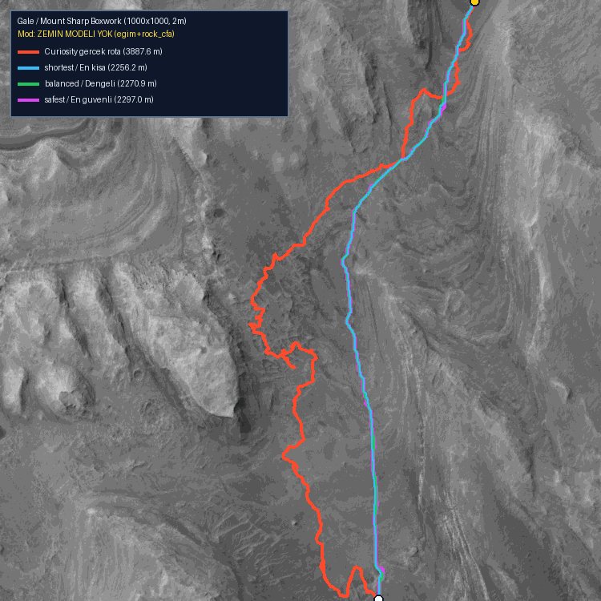

# Curiosity (MSL) Rotası ile Planlayıcı Doğrulaması (2026-11-14)

> **Durum Notu (Zemin Modeli Yok):** Zemin olasılık katmanları (`p_soil`, `p_bedrock`, `p_sand`, `p_bigrock`, `entropy`) henüz repoda olmadığından bu doğrulama **yalnız DEM eğimi (`slope.npy`) ve kaya yoğunluğu (`rock_cfa.npy`)** ile, tek tip referans zemin varsayımıyla (`p_bedrock=1.0`, `entropy=0.0`) koşulmuştur. **Zemin modeli katmanları geldiğinde `scripts/compare_msl.py` otomatik olarak tam modeli kullanacak ve bu rapor tekrar koşulacaktır.**

## 1. Yöntem
- **Bölge ve Izgara:** Gale / Mount Sharp boxwork kesiti (`1000×1000` hücre, `2.0 m/px`, `2×2 km`, USGS 1 m DEM v3 2×2 blok ortalaması ve 25 cm HiRISE ortofoto).
- **Referans Rota:** NASA/JPL MMGIS `MSL_traverse.json` kaydının (sol ~4459–4983) ızgaraya düşen kesiti (`layers/msl_proposed_path.json`, `854` nokta, `1785` örneklenmiş ızgara hücresi).
- **Uç Noktalar:** Referans yolun ızgaraya giriş hücresi `[790, 1]` (`[790.55, 1.38]`) ile çıkış hücresi `[629, 998]` (`[629.97, 998.58]`, kuş uçuşu `2019.8 m`) arasında `api.planner.plan()` ile 3 ön ayar (`shortest`, `balanced`, `safest`) üretilmiş ve `api.planner.comparison.compare_reference()` ile simetrik örneklenmiş nokta–polyline sapması ve tek yön süre/enerji farkları hesaplanmıştır.

## 2. Karşılaştırma Tablosu (`scripts/compare_msl.py` çıktısı)
- **Curiosity referans:** Polyline uzunluğu `3887.6 m` (ızgara hücre örneklemesi `4141.3 m`), aynı astronot yürüyüş modelinde tek yön eşdeğeri `177.0 dk` ve `844.4 kcal`; ortalama eğim `9.9°`, maksimum eğim `45.7°` (`≥25°` NOGO eşiğinde `35` hücre).

| Ön ayar | Uzunluk (m) | Δ Uzunluk (m) | Ort. Sapma (m) | Maks. Sapma (m) | Süre (dk) | Δ Süre (dk) | Enerji (kcal) | Δ Enerji (kcal) | Maks. Eğim (°) | Durum |
|---|---:|---:|---:|---:|---:|---:|---:|---:|---:|---|
| `shortest` (En kısa) | 2256.2 | -1631.3 | 140.0 | 326.0 | 69.5 | -107.5 | 323.7 | -520.6 | 18.6 | GO |
| `balanced` (Dengeli) | 2270.9 | -1616.7 | 140.3 | 326.0 | 69.7 | -107.4 | 324.6 | -519.8 | 19.9 | GO |
| `safest` (En güvenli) | 2297.0 | -1590.5 | 139.9 | 326.0 | 70.3 | -106.8 | 327.4 | -517.0 | 16.2 | GO |

*(Δ Uzunluk polyline `3887.6 m` referansına göredir; ızgara örneklemeli referans uzunluğa `4141.3 m` göre farklar sırasıyla `-1885.0 m`, `-1870.4 m` ve `-1844.3 m`'dir. Ham veriler: `docs/validation_msl.json`.)*

## 3. Görsel Karşılaştırma

## 4. Dürüst Yorum: Sapma Neden Var?
1. **Bilim Hedefleri vs. Noktadan Noktaya Geçiş:** Curiosity kuzeyden güneye inerken en kısa koridoru izlememiş; batıdaki boxwork sırtlarını, kırık dolgularını ve sondaj/görüntüleme duraklarını ziyaret etmek için zikzak çizmiştir (`3887.6 m` vs. kuş uçuşu `2019.8 m`). Planlayıcımız ise yalnız başlangıç `[790, 1]` ile bitiş `[629, 998]` arasındaki geçiş maliyetini minimize eder; `326.0 m` maksimum yanal sapma rover'ın batıdaki bilim ceplerine girdiği orta kesitte oluşur.
2. **Rover vs. Yaya (Astronot) Kısıtları:** Rover tekerlek kayması (kum tuzakları), şasi açıklığı ve enerji/güneş açısı kısıtlarıyla sürülürken, yaya planlayıcısı Pandolf metabolik enerjisini (`kcal/m`) ve Tobler yürüyüş süresini (`s/m`) optimize eder. `safest` ön ayarı kaya yoğunluğu (`rock_cfa`) ve dik yamaçlardan kaçınarak maksimum eğimi `18.6°` yerine `16.2°`'ye düşürmüştür.
3. **2 m DEM Çözünürlüğü ve Sırt Kenarı Abartısı:** 2 m DEM, dar boxwork sırt kenarlarında yerel eğimi abartmaktadır (referans rota üzerinde DEM'in `≥25°`, hatta `45.7°` gösterdiği `35` hücre vardır; oysa rover buradan güvenli eğimle geçmiştir). Planlayıcımız `≥25°` hücreleri kesin NOGO kabul ettiği için doğudaki daha yumuşak oluk koridorunu seçmiştir.

## 5. Sınırlar ve Sonraki Adım
- **Sınırlar:** Tek yön süre/kcal farkları (`-106.8…-107.5 dk`, `-517.0…-520.6 kcal`), Curiosity izinin aynı astronot modeliyle yürünmesi varsayımına dayanır; rover'ın gerçek sürüş süresi/enerjisi değildir. Şu an yalnız eğim ve `rock_cfa` etkindir, kum/ana kaya ayrımı (`p_*`) devre dışıdır.
- **Tekrar Koşum Notu:** AI4Mars tabanlı zemin olasılık katmanları (`p_soil`, `p_bedrock`, `p_sand`, `p_bigrock`, `entropy`) eklendiğinde `python scripts/compare_msl.py` komutu tekrar koşularak tablo ve görsel güncellenecektir.
