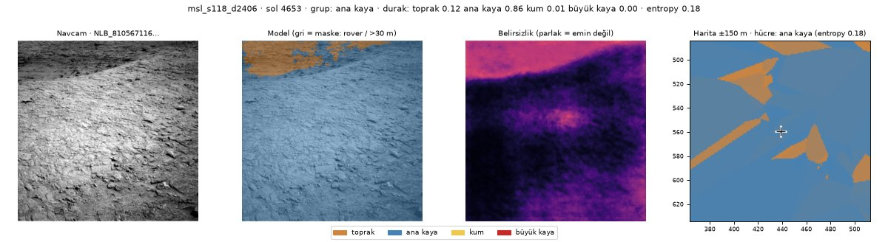
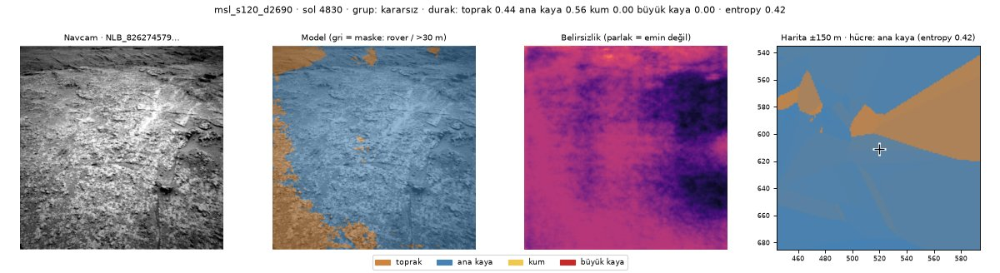

# Tarayıcı kanıtı: 6 durak (2026-11-14)

Issue #45. Kask tarayıcısının o duraktaki hücreye verdiği sınıf (API `scan_class`: güvenli / dikkat / geçilmez / bilinmiyor)
ile o durağın Navcam karesinde gözle görülen zemin.

## Sonuç tablosu (2026-11-14)
| Durak | `scan_class` (neden) | Navcam'de görülen | Sonuç | Gerekçe |
|---|---|---|---|---|
| s118_d0726 | güvenli (eğim 6,5°, kum 0,00) | düz ana kaya, dağınık çakıl | **tuttu** | Düz, kayalık, kumsuz zemin; güvenli doğru. |
| s118_d2406 | dikkat (eğim 21,8° ≥ 15°) | eğimli ana kaya yüzeyi, üstte sırt | **tuttu** | Karede eğimli yüzey görülüyor; dikkat yerinde. |
| s120_d2690 | dikkat (eğim 15,8° ≥ 15°) | pürüzlü ana kaya, kenarda toprak | **tuttu** | Pürüzlü ve eğimli; dikkat yerinde. |
| s118_d1608 | güvenli (eğim 14,8°, kum 0,02) | dalgalı kaya çıkıntıları, arada kum | **kısmen** | Zemin sınıfı doğru (kaya) ama yüzey çok pürüzlü; eğim eşiğin hemen altında kaldığı için güvenli denmiş. |
| s120_d2366 | güvenli (kum 0,37 < 0,40) | rover izinde kum + çakıl | **tutmadı** | Model kumu gördü (0,37) ama dikkat eşiğinin (0,40) hemen altında kaldı. |
| s120_d3056 | güvenli (kum 0,21) | kaya plakaları arasında yoğun kum | **tutmadı** | Model kumu ana kaya sandı; tarayıcı kumlu yeri güvenli gösteriyor. |

**Özet: 6 duraktan 3'ünde tuttu, 1'inde kısmen, 2'sinde tutmadı. Tutmayan ikisi de kumlu durak.**

Notlar:
- `scan_class` öncelik sırası: geçilmez → bilinmiyor → dikkat → güvenli (`api/planner/params.py`). Durak hücrelerinde
  "bilinmiyor" yok, çünkü durağın kendisi kanıt. Haritanın tamamında hücrelerin %50,6'sı bilinmiyor, %22,7'si güvenli,
  %7,9'u dikkat, %18,7'si geçilmez.
- **Bulgu:** Tarayıcı kuralı modelin büyük kaya olasılığını (`p_bigrock`) kullanmıyor; kaya için yalnız yörüngeden ölçülen
  `rock_cfa` var ve bu 6 hücrede 0. s118_d1608'de model %33 büyük kaya diyor ama tarayıcıya yansımıyor.
  Bu kural planlayıcı sahibinin kararı; burada yalnız gözlem olarak not edildi.
- Kum eşiği 0,40. Model bu bölgede kumu az tahmin ettiği için (`LAYERS.md`: 7 kumlu duraktan 2'si) kumlu duraklar
  güvenli görünebiliyor. Simülatörde yolda kum çıkınca `/replan` devreye giriyor; bu boşluğu o kapatıyor.

## Görseller
Her görselde soldan sağa:
1. Navcam karesi
2. Modelin segmentasyonu (gri = rover gövdesi ve 30 m ötesi, maskeli)
3. MC Dropout belirsizliği
4. Haritada durağın ±150 m çevresi; artı işareti durak, griye kayan hücre = belirsiz

Model: 12 epoch, sınıf ağırlıklı (`METRICS.md`). Katmanlar: PR #80 (128 durak).

"Göz" sütunu Emre'nin kareleri elle incelemesinden. Bu kesin bir yer gerçeği değil, ama bu bölge için uzman etiketi olmadığından elimizdeki tek bağımsız kontrol. Durak değeri, durağın tüm karelerinin ortalaması; görseldeki tek kare bundan farklı olabilir.

Üretim: `python ml/rover_terrain/scan_check.py <img_dir> --model models/rover_terrain/full/best.pt`

## Kumlu duraklar

### s120_d2366 (sol 4827): kısmen tuttu

- **Göz:** Rover izi kum ve çakıl. Bu karede ana kaya, kum ve toprak bir arada.
- **Model, bu kare:** toprak %81, ana kaya %18, kum %1.
- **Durak (4 kare):** toprak 0,54, kum 0,37. Kum rover izinin olduğu karelerden geliyor.
- **Harita hücresi:** toprak (entropy 0,41).
- **Sonuç:** Kumu durak düzeyinde yakaladı. Ama bu karedeki kumlu yüzeye "toprak" dedi; ana kaya şeridini doğru ayırdı.
- **Maske sınırı:** Bu durağın 2. karesinde (`…826009205…`) maske robot kolunun bir kısmını kaçırıyor ve model oraya kum diyor.
  Durağın kum payı (0,37) bu yüzden biraz şişkin olabilir. Kolsuz 4. karede (`…826010468…`) kum payı 0,50, yani kum gerçek.

### s120_d3056 (sol 4834): tutmadı

- **Göz:** Kum yoğun, büyük kaya var, ana kaya az.
- **Model, bu kare:** ana kaya %81, toprak %16, kum %1.
- **Durak:** ana kaya 0,63, kum 0,21.
- **Harita hücresi:** ana kaya (entropy 0,24).
- **Sonuç:** Kaya plakalarının arasındaki koyu, düz kumu ana kaya saydı. Hem baskın sınıf hem kum payı yanlış, üstelik model düşük belirsizlikle "emin". **Model nerede yanılıyor slaytı için en iyi örnek.**

## Ana kaya durakları

### s118_d0726 (sol 4625): tuttu

- **Göz:** Ana kaya çoğunlukta.
- **Model:** bu kare ana kaya %88. Durak ana kaya 0,92, entropy 0,12.
- **Harita hücresi:** ana kaya.
- **Sonuç:** Tuttu ve emin. 1 epoch'luk model burada toprak 0,57 demişti; tam eğitim düzeltti.

### s118_d2406 (sol 4653): tuttu

- **Göz:** Ana kaya yoğunluklu.
- **Model:** bu kare ana kaya %88. Durak ana kaya 0,86, entropy 0,18.
- **Harita hücresi:** ana kaya.
- **Sonuç:** Tuttu. Belirsizlik yalnız uzak ve ufka yakın şeritte yüksek. 1 epoch'luk model burada toprak 0,75 demişti.

## Modelin kararsız olduğu duraklar

### s118_d1608 (sol 4634): tutmadı (büyük kaya yanlış alarmı)

- **Göz:** Ana kaya yoğun, kum var.
- **Model, bu kare:** büyük kaya %58, ana kaya %36.
- **Durak:** ana kaya 0,49, büyük kaya 0,33, entropy 0,36.
- **Harita hücresi:** ana kaya.
- **Sonuç:** Koyu, dalgalı kaya çıkıntılarını büyük kaya saydı. Sınıf ağırlığının yan etkisi bu (test kümesindeki yanlış alarm bulgusu, `METRICS.md`). Kum da kaçtı. Belirsizlik ana kaya/büyük kaya sınırında yüksek; model burada kararsızlığını doğru gösteriyor.

### s120_d2690 (sol 4830): tuttu (kararsız)

- **Göz:** Ana kaya yoğun, uzakta toprak.
- **Model, bu kare:** ana kaya %70, toprak %30 (kenarlarda).
- **Durak:** ana kaya 0,56, toprak 0,44, entropy 0,42.
- **Harita hücresi:** ana kaya.
- **Sonuç:** Tuttu. Pürüzlü, açık tonlu yüzeyde belirsizlik geniş bir alanda orta düzeyde; "emin değilim" demesi yerinde.

## Zemin modeli düzeyinde özet (görsellerdeki sınıf karşılaştırması)
| Durak | Grup | Zemin sınıfı sonucu |
|---|---|---|
| s120_d2366 | kumlu | kısmen |
| s120_d3056 | kumlu | **tutmadı** |
| s118_d0726 | ana kaya | tuttu |
| s118_d2406 | ana kaya | tuttu |
| s118_d1608 | kararsız | **tutmadı** |
| s120_d2690 | kararsız | tuttu |

**Model nerede yanılıyor:**
1. **Kum, ana kaya ya da toprak sanılıyor.** Hem bu altı durakta hem 18 durağın elle kontrolünde (görülen 7 kumlu duraktan 2'si yakalandı; `LAYERS.md`).
2. **Dokulu kaya çıkıntıları büyük kaya sanılıyor.** Bu, sınıf ağırlığının bedeli.

Ana kayayı ise güvenilir biçimde tanıyor. Belirsizlik çoğunlukla gerçekten zor yerlerde yükseliyor. Tek istisna s120_d3056: orada model yanılırken de emin.

**Harita notu:** Harita hücresi en yakın durağın değerini alıyor (Voronoi). Kırpmalardaki keskin çokgen sınırlar bu yöntemden geliyor, arazinin gerçek sınırları değil.
